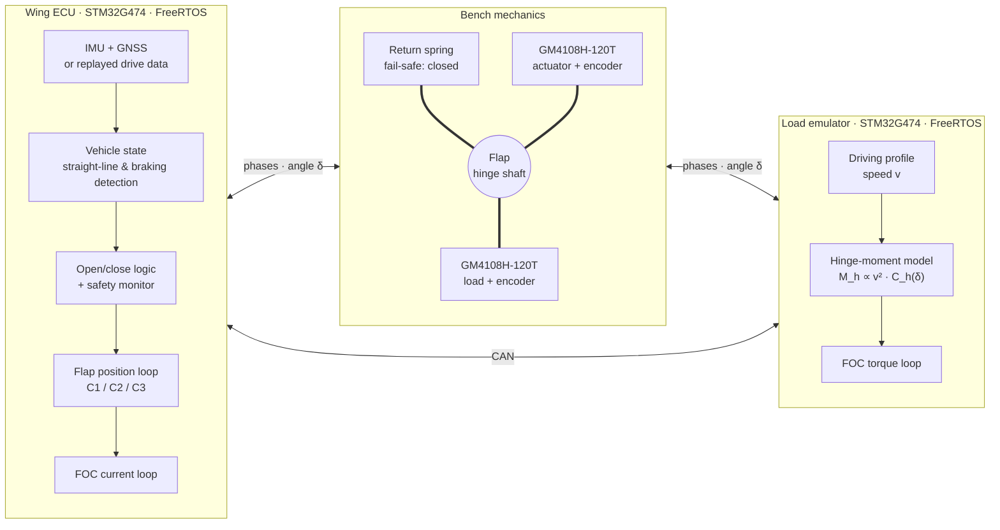

# WingECU

**Real-time embedded control of an active rear wing (DRS) under emulated aerodynamic load.**

WingECU is a small, student-built test bench inspired by the Formula 1 Drag Reduction System. The goal is to study the embedded control problem, not to reach F1-level performance. A 3D-printed rear-wing flap is driven by a direct-drive gimbal brushless motor, while a second, identical motor emulates a scaled aerodynamic hinge torque, proportional to v². Both boards run FreeRTOS on STM32G474 microcontrollers and talk over CAN.

> **Status:** project proposal approved, sizing in progress (M1).
> Developed as the project of the course *Embedded Systems and AI, Module 1* (University of Trento, MSc Intelligent Mechatronics Engineering).

## Goals

The central question is how much the control strategy matters when the flap must close fast and reliably under load. Three controllers are compared on the same bench: a PID (C1), a PID with feedforward of the modelled aerodynamic torque (C2), and a PID with a disturbance observer (C3).

Each controller is evaluated on four groups of measurements. Control performance covers the tracking error and the closing time under load, with a target below 100 ms. Timing covers the end-to-end braking delay split stage by stage, the CAN latency between the two boards, and the latency, jitter and execution time of each FreeRTOS task. Safety is assessed by injecting faults (power cut, lost encoder, frozen task, lost CAN messages), with the flap expected back in its safe position within 200 ms. Power and energy are measured on board, per opening cycle, while holding the flap open and over a full lap, including the effect of the return-spring stiffness.

## System overview

The Wing ECU decides on its own when to open the flap (straight line detected) and when to close it (braking detected). On the bench the board does not move, so the vehicle state comes from replayed driving data instead of the IMU and GNSS. The load emulator applies the scaled hinge moment on the same shaft, and the return spring brings the flap back to the closed, high-downforce position if control is lost.

| Parameter | Value |
|---|---|
| Torque scale factor (bench / F1) | about 1/300, provisional, fixed after the M1 motor measurements ([s02](matlab/sizing/s02_scale_factor.m)) |
| Hinge axis position | 0.55 · c |
| Flap opening | 40° |
| Motors | 2 × GM4108H-120T (identical) |
| Fail-safe | low-stiffness preloaded return spring (flap closes on power loss) |
| MCU | 2 × STM32G474 (identical boards) |
| RTOS / language | FreeRTOS, C |

## Repository layout

| Folder | Contents |
|---|---|
| `hardware/` | KiCad projects (ECU board, shared by both nodes) |
| `firmware/wing-ecu/` | Flap controller firmware |
| `firmware/load-emulator/` | Aerodynamic load emulator firmware |
| `firmware/common/` | Code shared by both nodes (CAN protocol, drivers) |
| `cad/` | Mechanical parts (flap, hinge, motor mounts) |
| `matlab/` | Sizing scripts and control models |
| `test-bench/` | Test procedures and data-logging scripts |
| `results/` | Measured data and plots |
| `docs/` | [Project proposal](docs/proposal/), [bill of materials](docs/bom.xlsx), roadmap, images |

## Roadmap

Detailed tasks are tracked in [`docs/roadmap.md`](docs/roadmap.md).

| Milestone | Content | Status |
|---|---|---|
| M1 | Hardware, FOC and position loop without load, sensors and instrumentation | In progress |
| M2 | Two-motor bench with load emulation, C1 to C3 compared on synthetic laps | Planned |
| M3 | Real driving data, braking detection, fault injection, measurement campaign, report | Planned |

## License

Hardware design files are released under the CERN Open Hardware Licence Version 2, Permissive (CERN-OHL-P-2.0), software under the MIT License, and documentation under CC-BY-4.0. See [LICENSE.md](LICENSE.md) for the folder-by-folder details.

## Author

Gabriel Chuffart, MSc Intelligent Mechatronics Engineering, University of Trento
