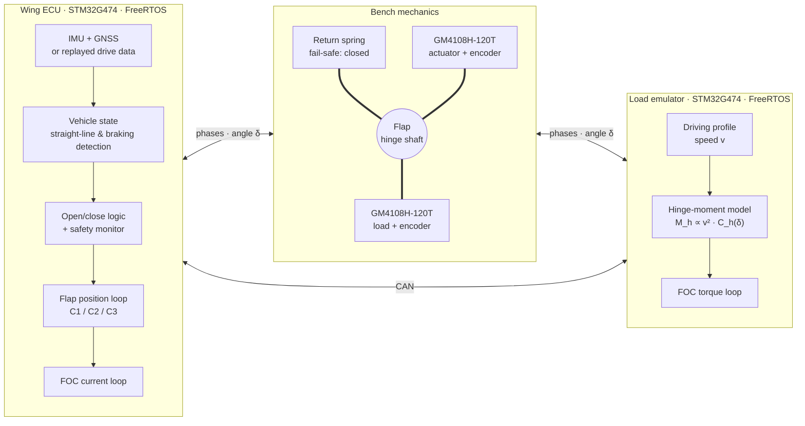

# WingECU

**Real-time embedded control of an active rear wing (DRS) under emulated aerodynamic load.**

WingECU is a small, student-built test bench inspired by the Formula 1 Drag Reduction System. The goal is to study the embedded control problem, not to reach F1-level performance. A 3D-printed rear-wing flap is driven by a direct-drive gimbal brushless motor, while a second, identical motor emulates a scaled aerodynamic hinge torque (proportional to v²). Both boards run FreeRTOS on STM32G474 microcontrollers and talk over CAN.

> **Status:** project proposal approved — hardware sizing in progress (M1).
> Developed as the project for *Embedded Systems and AI – Module 1* (University of Trento, MSc Intelligent Mechatronics Engineering).

## Goals

The central question is how much the control strategy matters when the flap must close fast and reliably under load. Three controllers are compared on the same bench:

1. PID
2. PID + aerodynamic-torque feedforward
3. PID + disturbance observer

Measured outputs:

- **control**: tracking error and closing time under load (target < 100 ms)
- **delays**: end-to-end braking delay split stage by stage, CAN latency, task latency/jitter/execution time under FreeRTOS
- **safety**: reaction to injected faults (power cut, encoder lost, frozen task, lost CAN) — target < 200 ms to the safe position
- **power and energy**: on-board power monitoring, energy per cycle, holding power, energy per lap, effect of return-spring stiffness

## System overview

| Parameter | Value |
|---|---|
| Scale factor | 1:50 |
| Hinge axis position | 0.55 · c |
| Flap opening | 40° |
| Motors | 2 × GM4108H-120T (identical) |
| Fail-safe | low-stiffness preloaded return spring (flap closes on power loss) |
| MCU | 2 × STM32G474 (identical boards) |
| RTOS / language | FreeRTOS, C |

## Repository layout

| Folder | Contents |
|---|---|
| `hardware/` | KiCad projects (ECU board, shared by both nodes) |
| `firmware/wing-ecu/` | Flap controller firmware |
| `firmware/load-emulator/` | Aerodynamic load emulator firmware |
| `firmware/common/` | Code shared by both nodes (CAN protocol, drivers) |
| `cad/` | Mechanical parts (flap, hinge, motor mounts) |
| `matlab/` | Sizing scripts and control models |
| `test-bench/` | Test procedures and data-logging scripts |
| `results/` | Measured data and plots |
| `docs/` | [Project proposal](docs/proposal/), design notes, roadmap, images |

## Roadmap

See [`docs/roadmap.md`](docs/roadmap.md).

- [ ] **M1** — Hardware, FOC and position loop without load, sensors and instrumentation
- [ ] **M2** — Two-motor bench with load emulation, C1–C3 compared on synthetic laps
- [ ] **M3** — Real driving data, braking detection, fault injection, measurement campaign, report

## Author

Gabriel Chuffart — MSc Intelligent Mechatronics Engineering, University of Trento
